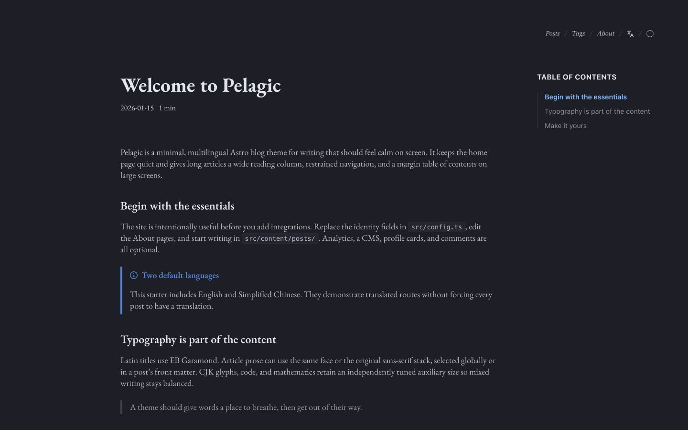
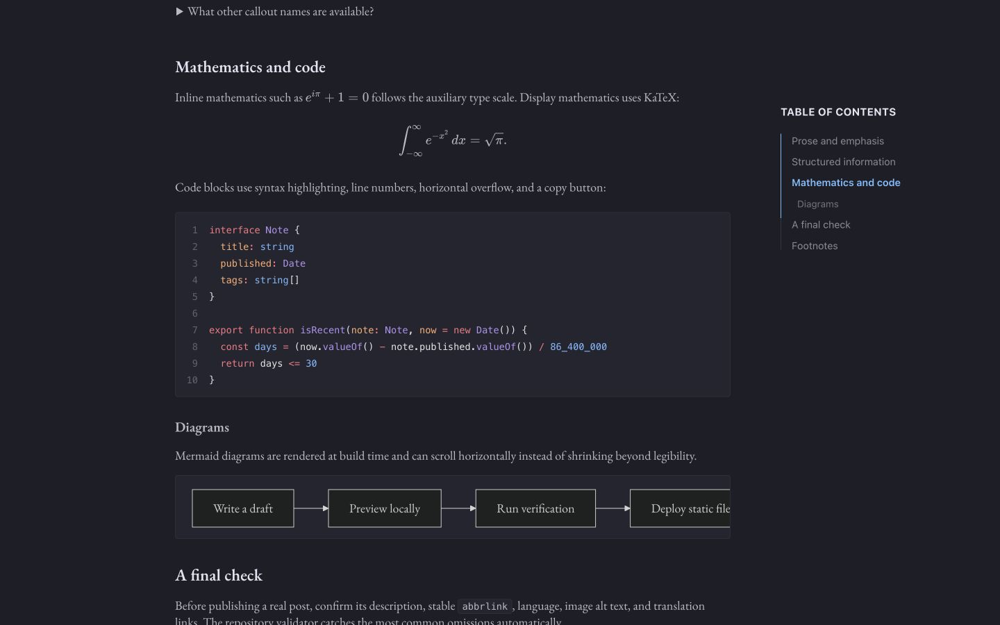

<p align="center">
  
</p>

<h1 align="center">Pelagic</h1>

<p align="center">
  A typography-first, multilingual Astro blog theme for essays, notes, and research.
</p>

<p align="center">
  <a href="README.md">English</a> · <a href="README.zh-CN.md">简体中文</a> · <a href="https://leanderc.com">Live demo</a>
</p>

<p align="center">
  <a href="https://github.com/Parsnip77/astro-theme-pelagic/actions/workflows/verify.yml"></a>
  <a href="https://astro.build/"></a>
  <a href="LICENSE"></a>
</p>



Pelagic keeps the home page quiet and text-only, then gives long-form posts a wider reading column, fixed corner navigation, and a responsive margin table of contents. It is a reusable derivative of [Retypeset](https://github.com/radishzzz/astro-theme-retypeset); the public defaults contain no personal content from the [live design](https://leanderc.com).

## Why Pelagic

- Typography before decoration: EB Garamond Latin titles and optional prose, balanced CJK fallbacks, and separate sizing for math and code.
- Long-form reading: a `50rem` article column, smooth two-level margin TOC, readable tables, and horizontally scrollable diagrams.
- Multilingual by design: English and Simplified Chinese examples, plus interface translations for 11 locales.
- Static and private by default: no database, CMS, analytics, remote fonts, or comments unless you enable them.
- Rich writing surface: Markdown and MDX, KaTeX, Mermaid, syntax highlighting, callouts, folds, embeds, RSS/Atom, sitemap, and generated Open Graph images.
- Deployment-aware: root domains, GitHub user sites, and GitHub project subpaths are handled by the same source tree.



## Quick start

Requirements: Node.js 22 or newer and pnpm 11.

```bash
git clone https://github.com/Parsnip77/astro-theme-pelagic.git my-blog
cd my-blog
pnpm install
pnpm dev
```

Open `http://localhost:4321`. Before publishing:

1. Edit identity, languages, typography, layout, and links in `src/config.ts`.
2. Edit localized site text in `src/i18n/ui.ts` when `site.i18nTitle` is enabled.
3. Replace the About pages and sample posts under `src/content/`.
4. Replace the favicon and social assets in `public/` if desired.
5. Run `pnpm verify:release`.

## Write a post

```bash
pnpm new-post my-first-post
```

This creates a draft in `src/content/posts/`. A published post needs a description, language, and stable `abbrlink`.

```yaml
---
title: My First Post
published: 2026-01-20
description: A concise summary for lists, feeds, and search metadata.
tags:
  - Notes
draft: false
toc: true
bodyFont: garamond
bodyFontSize: 18
bodyAuxFontSize: 16
lang: en
abbrlink: my-first-post
---
```

Translations share the same `abbrlink` and use different `lang` values. Pelagic only links translations that actually exist.

## Configuration at a glance

Most owner-facing settings live in one file:

```ts
export const themeConfig = {
  site: { title: 'Pelagic', author: 'Your Name', i18nTitle: true },
  locale: { default: 'en', additional: ['zh'] },
  typography: { postBodyFont: 'garamond' },
  layout: { articleWidth: '50rem', tocWidth: '16rem' },
  comments: { enabled: false },
}
```

See the [configuration reference](docs/configuration.md) for every setting and the [content guide](docs/content.md) for supported Markdown syntax.

## Deploy to GitHub Pages

The included workflow builds and deploys every push to `main`.

1. Push the repository to GitHub.
2. Open **Settings → Pages**.
3. Choose **GitHub Actions** as the source.
4. Push again or run **Deploy to GitHub Pages** manually.

Pelagic automatically distinguishes `<owner>.github.io` from a project repository such as `my-blog`. Custom domains use the `SITE_URL` repository variable and `public/CNAME`. Follow the [deployment guide](docs/deployment.md) for exact scenarios.

## Verification

```bash
pnpm check             # Astro and TypeScript diagnostics
pnpm build             # production build and generated-link validation
pnpm verify            # lint, config/docs checks, build, responsive browser tests
pnpm verify:release    # verify plus a GitHub project-subpath build
```

The CI suite checks content metadata and route stability, documentation references, root and subpath builds, canonical/internal URLs, draft isolation, image alternative text, and responsive layouts at 390, 1280, 1440, and 1920 pixels. Read the [testing guide](docs/testing.md) for the complete matrix.

## Documentation

| English | 简体中文 |
| --- | --- |
| [Configuration](docs/configuration.md) | [配置参考](docs/zh-CN/configuration.md) |
| [Content authoring](docs/content.md) | [内容写作](docs/zh-CN/content.md) |
| [Deployment](docs/deployment.md) | [部署指南](docs/zh-CN/deployment.md) |
| [Testing](docs/testing.md) | [测试说明](docs/zh-CN/testing.md) |
| [Screenshot gallery](docs/showcase.md) | [截图与效果](docs/zh-CN/showcase.md) |

## Project structure

```text
src/config.ts             Site, typography, layout, and feature settings
src/i18n/                 Interface translations and locale routing
src/content/about/        Localized About pages
src/content/posts/        Markdown and MDX posts
src/components/           Astro UI components and widgets
src/styles/               Theme and typography styles
public/                   Fonts, icons, feeds, and optional CNAME
scripts/                  Authoring and validation utilities
tests/                    Responsive layout regression tests
.github/workflows/        Verification and GitHub Pages deployment
```

## Credits and license

Pelagic is derived from [Retypeset](https://github.com/radishzzz/astro-theme-retypeset). Source code is available under the MIT License. Original Retypeset notices are retained, and Pelagic modifications are copyright © 2026 Parsnip77. Bundled fonts and the Giscus theme base keep their respective licenses.

See [LICENSE](LICENSE), [NOTICE.md](NOTICE.md), and [THIRD_PARTY_LICENSES.md](THIRD_PARTY_LICENSES.md).
