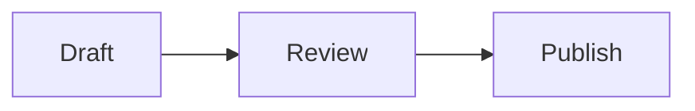

# Content authoring

Posts live in `src/content/posts/` and About pages live in `src/content/about/`. Both Markdown (`.md`) and MDX (`.mdx`) are supported.

## Create a draft

```bash
pnpm new-post notes/my-new-essay
```

The script creates `src/content/posts/notes/my-new-essay.md`. New files are drafts and inherit the default locale and typography from `src/config.ts`.

## Post front matter

| Field | Required to publish | Description |
| --- | --- | --- |
| `title` | Yes | Display and metadata title. |
| `published` | Yes | YAML date or full ISO timestamp. |
| `description` | Yes | Used in lists, feeds, and metadata. |
| `updated` | No | Last meaningful revision date. |
| `tags` | No | Array of tag labels. |
| `draft` | No | Drafts appear only in development. Default `false`. |
| `pin` | No | `1`–`99` pins and orders a post; `0` is unpinned. |
| `toc` | No | Enables the article margin TOC. |
| `bodyFont` | No | `garamond` or `sans`. |
| `bodyFontSize` | No | Article body size from 14 through 24 pixels. |
| `bodyAuxFontSize` | No | CJK, code, and math size from 12 through 24 pixels. |
| `lang` | Yes | An enabled locale, or `''` for universal content. |
| `abbrlink` | Yes | Stable lowercase URL slug containing letters, numbers, and hyphens. |

Changing a filename does not change the public URL when `abbrlink` stays the same. Changing or deleting an `abbrlink` is a public URL change and is caught by `content-route-manifest.json`.

## Translations

Give translations the same `abbrlink` and distinct `lang` values:

```text
my-essay-en.md  → lang: en, abbrlink: my-essay
my-essay-zh.md  → lang: zh, abbrlink: my-essay
```

The language switcher and alternate metadata include only translations that exist. A post with `lang: ''` is intentionally shared by every enabled locale; use this only when identical content is appropriate everywhere.

## Markdown features

Standard Markdown includes headings, emphasis, links, ordered and unordered lists, task lists, block quotes, tables, fenced code, and footnotes.

### Callouts

```md
:::note[Optional custom title]
Supporting information.
:::

:::tip
A practical suggestion.
:::
```

Available types are `note`, `tip`, `important`, `warning`, and `caution`. GitHub-style `> [!NOTE]` block quotes are also recognized.

### Collapsible sections

```md
:::fold[Read the details]
Content hidden until the reader opens it.
:::
```

The title is required. Fold summaries follow the selected article body font.

### Mathematics

Use `$...$` for inline math and `$$...$$` for display math. KaTeX is enabled by default.

```md
$$
\sum_{k=1}^{n} k = \frac{n(n+1)}{2}
$$
```

Avoid placing display-math delimiters on the same line as surrounding prose. Complex annotations can be clipped when TeX constructs create unusually deep boxes; prefer `\text{short label}` or move long prose below the formula.

### Mermaid

````md

````

Diagrams are rendered during the build. Wide diagrams scroll horizontally rather than shrinking indefinitely.

### Media directives

Pelagic supports leaf directives for selected embeds:

```md
::github{repo="withastro/astro"}
::youtube{id="VIDEO_ID"}
::bilibili{id="BV_ID"}
::tweet{url="https://x.com/user/status/ID"}
::codepen{url="https://codepen.io/user/pen/SLUG"}
::spotify{url="https://open.spotify.com/track/ID"}
```

Embeds contact third-party services in the reader's browser. Omit them when a fully local, privacy-minimal site is desired.

## Images

For content images, place source files under `src/content/posts/_images/` and reference them relatively from the post. Astro can then optimize them and the feed generator can produce absolute URLs.

```md

```

Every image must have meaningful alternative text. Prefix the alt text with `_` only when intentionally suppressing Pelagic's visible figure caption; the alt text itself is still retained.

Files referenced from `public/` need the configured deployment base path. Content-local images are therefore the safer choice for a theme that may be published under a GitHub repository subpath.

## Tables and manual wrapping

Tables use intrinsic column widths and horizontal scrolling. This keeps code, formulas, and complexity notation from breaking at arbitrary points. If a cell should wrap, insert an explicit HTML line break such as `<br>` at a meaningful boundary.

## Publishing checklist

1. Change `draft` to `false`.
2. Fill `description`, `lang`, and `abbrlink`.
3. Run `pnpm content:manifest` if the route set changed intentionally.
4. Run `pnpm verify`.
5. Commit the post, local images, and updated route manifest together.
