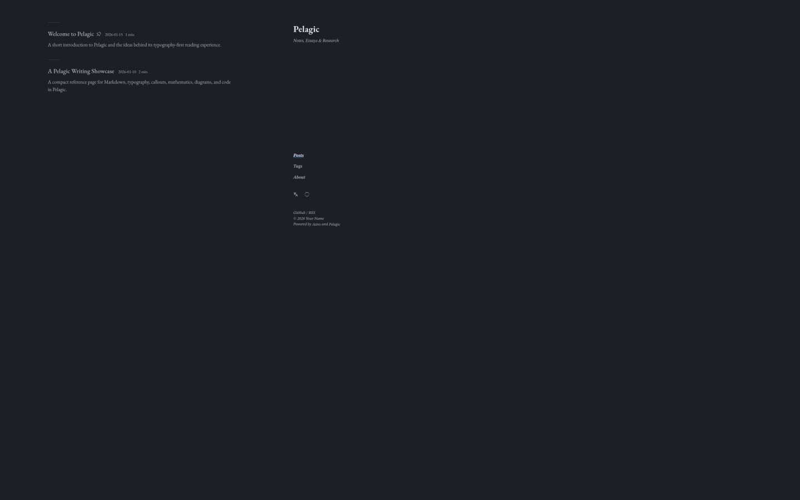
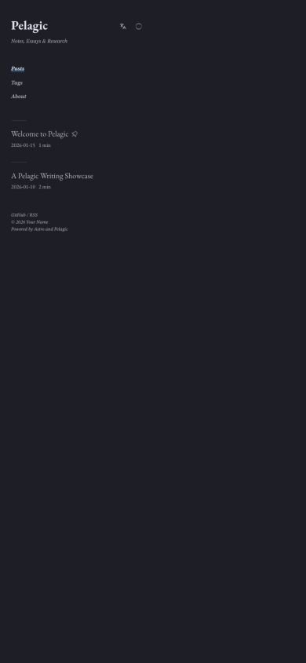
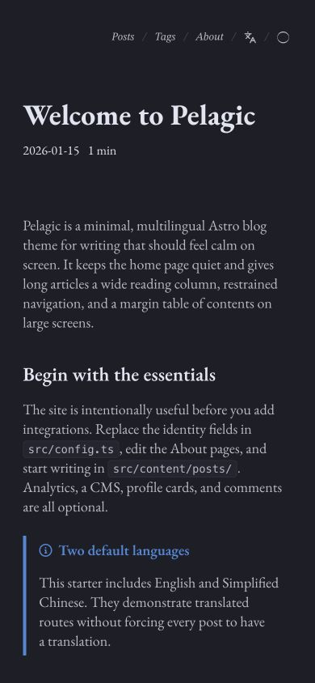

# Screenshot gallery

These images are captured from the unmodified English and Simplified Chinese starter content. The live derivative at [leanderc.com](https://leanderc.com) may contain later personal customizations.

[简体中文](zh-CN/showcase.md)

## Home page

The home page deliberately avoids hero images, profile cards, and dashboards. It keeps the title, navigation, post list, and language/theme controls in a restrained text layout.

## Article and margin TOC

On wide screens the article shifts left enough to reserve a separate margin for the table of contents. On compact screens the reading column returns to a conventional single-column layout.

## Mathematics, code, and diagrams

KaTeX, syntax-highlighted code, Mermaid, and wide tables retain their own typographic scale. Oversized diagrams and tables scroll instead of shrinking text until it becomes unreadable.

## Mobile

  
  

The corner navigation remains reachable without creating a persistent mobile sidebar. Article typography, code, and auxiliary glyph sizes remain independently configurable.
