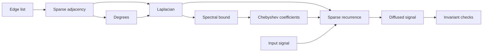

## Abstract

Diffusion on a graph is a small mathematical idea with an unusually wide computational reach. It appears in ranking, denoising, semi-supervised learning, consensus dynamics, heat-kernel signatures, and the propagation layers of graph neural networks. This paper develops the subject from the combinatorial Laplacian to polynomial and Krylov approximations, with an emphasis on the boundary between a clean spectral formula and an implementation that remains stable on a large sparse graph.

The central object is the heat operator

$$
H_t = \exp(-tL), \qquad t \ge 0,
$$

where $L$ is a graph Laplacian. The exact eigendecomposition makes the geometry transparent; fast solvers replace it with local recurrences, sparse matrix products, and controlled approximation error.

:::note[Notation]
Vectors are columns. For a real symmetric matrix $A$, its ordered eigenvalues are $\lambda_1(A) \le \cdots \le \lambda_n(A)$. The Euclidean and operator norms are both written $\lVert\cdot\rVert_2$; context distinguishes them.
:::

## 1. Graphs, Signals, and Laplacians

Let $G=(V,E,w)$ be an undirected weighted graph with $n=|V|$. Its adjacency matrix $A\in\mathbb{R}^{n\times n}$ satisfies $A_{ij}=w_{ij}=w_{ji}\ge 0$, and its degree matrix is

$$
D = \operatorname{diag}(d_1,\ldots,d_n),
\qquad
d_i = \sum_{j=1}^{n} A_{ij}.
$$

The **combinatorial Laplacian**, the **symmetric normalized Laplacian**, and the **random-walk Laplacian** are respectively

$$
L = D-A,
\qquad
L_{\mathrm{sym}} = I-D^{-1/2}AD^{-1/2},
\qquad
L_{\mathrm{rw}} = I-D^{-1}A.
$$

For isolated vertices, inverse degree factors are defined as zero. A graph signal is a vector $x\in\mathbb{R}^n$ whose coordinate $x_i$ is attached to vertex $i$.

### 1.1 The quadratic form

The identity

$$
x^\top Lx
= \frac12\sum_{i,j=1}^{n}A_{ij}(x_i-x_j)^2
= \sum_{\{i,j\}\in E}w_{ij}(x_i-x_j)^2
$$

immediately proves $L\succeq 0$. It also explains why low-frequency signals are smooth: they vary little across heavily weighted edges.

:::important[Energy principle]
The Laplacian is not merely a matrix encoding adjacency. Its quadratic form assigns energy to disagreement. Diffusion decreases that energy while preserving mass on each connected component.
:::

If $G$ has $c$ connected components, then

$$
\dim\ker L = c,
$$

and the indicator vectors of the components span the null space. For a connected graph, $\lambda_1=0$ is simple and the **spectral gap** $\lambda_2>0$ controls the slowest nonconstant mode.

### 1.2 A small example

For the path graph on four vertices,

$$
L=
\begin{bmatrix}
 1 & -1 & 0 & 0 \\
 -1 & 2 & -1 & 0 \\
 0 & -1 & 2 & -1 \\
 0 & 0 & -1 & 1
\end{bmatrix}.
$$

Applying $L$ to $x=(1,1,0,0)^\top$ yields $(0,1,-1,0)^\top$: only the boundary across which the signal changes contributes to the discrete derivative.

## 2. Heat Flow and Spectral Filtering

The continuous-time diffusion equation is

$$
\frac{d}{dt}x(t)=-Lx(t),
\qquad x(0)=x_0.
$$

Because $L$ is symmetric, it admits $L=U\Lambda U^\top$, where $U^\top U=I$ and $\Lambda=\operatorname{diag}(\lambda_1,\ldots,\lambda_n)$. Therefore

$$
x(t)=e^{-tL}x_0
=Ue^{-t\Lambda}U^\top x_0
=\sum_{k=1}^{n}e^{-t\lambda_k}\langle u_k,x_0\rangle u_k.
$$

Each eigenvector $u_k$ is a graph Fourier mode, and $e^{-t\lambda_k}$ is a low-pass multiplier. Large eigenvalues decay rapidly; the null-space component remains.

:::tip[Sanity checks for an implementation]
For an undirected graph, a computed heat operator should be symmetric, positive definite for finite $t$, contractive in the $2$-norm, and mass-preserving: $H_t\mathbf{1}=\mathbf{1}$.
:::

### 2.1 Long-time behavior

On a connected graph,

$$
\lim_{t\to\infty}e^{-tL}
=u_1u_1^\top
=\frac{1}{n}\mathbf{1}\mathbf{1}^\top.
$$

Moreover, for every $x_0$ orthogonal to $\mathbf{1}$,

$$
\lVert e^{-tL}x_0\rVert_2
\le e^{-t\lambda_2}\lVert x_0\rVert_2.
$$

This inequality makes the spectral gap operational: to reduce the nonconstant component by a factor $\varepsilon$, it is enough that

$$
t \ge \frac{1}{\lambda_2}\log\frac{1}{\varepsilon}.
$$

### 2.2 Resolvents and regularization

The heat kernel is one member of a larger family of spectral filters. Tikhonov smoothing solves

$$
x_\mu
=\arg\min_x\left\{
\frac12\lVert x-y\rVert_2^2
+\frac{\mu}{2}x^\top Lx
\right\},
$$

so the optimality condition gives

$$
(I+\mu L)x_\mu=y,
\qquad
x_\mu=(I+\mu L)^{-1}y.
$$

In the graph Fourier basis, the multiplier is $(1+\mu\lambda)^{-1}$. Heat diffusion suppresses high frequencies exponentially; the resolvent suppresses them rationally.

| Filter | Spectral response $g(\lambda)$ | Typical use |
| --- | --- | --- |
| Heat | $e^{-t\lambda}$ | Multiscale smoothing |
| Resolvent | $(1+\mu\lambda)^{-1}$ | Regularized estimation |
| Lazy random walk | $(1-\alpha\lambda)^k$ | Local propagation |
| Ideal cutoff | $\mathbf{1}_{\lambda\le\tau}$ | Analysis, rarely direct computation |

## 3. Discretization and Stability

The explicit Euler scheme with step size $h$ is

$$
x_{k+1}=(I-hL)x_k.
$$

Stability requires $|1-h\lambda_i|\le 1$ for every $i$, hence

$$
0\le h\le\frac{2}{\lambda_{\max}(L)}.
$$

If one additionally wants $I-hL$ to be entrywise nonnegative for the combinatorial Laplacian, the stricter sufficient condition $h\le 1/d_{\max}$ is natural.

:::warning[The innocent-looking step size]
Choosing $h$ from wall-clock convenience rather than the spectrum can create oscillation or divergence. On heterogeneous graphs, a step that is safe for the average degree may be unsafe for a hub.
:::

The implicit Euler scheme,

$$
(I+hL)x_{k+1}=x_k,
$$

is unconditionally stable but requires a linear solve. Crank–Nicolson uses

$$
\left(I+\frac{h}{2}L\right)x_{k+1}
=\left(I-\frac{h}{2}L\right)x_k,
$$

and is second-order accurate, though not necessarily monotone for large $h$.

### 3.1 Error decomposition

For a numerical approximation $\widetilde{x}(t)$, it is useful to separate

$$
\lVert \widetilde{x}(t)-e^{-tL}x_0\rVert_2
\le
\underbrace{\lVert \widetilde{x}(t)-p_m(L)x_0\rVert_2}_{\text{arithmetic/solver error}}
+
\underbrace{\lVert p_m(L)-e^{-tL}\rVert_2\lVert x_0\rVert_2}_{\text{approximation error}}.
$$

The separation prevents a common debugging mistake: increasing floating-point precision cannot repair a polynomial of insufficient degree.

## 4. Fast Approximation Without Eigenvectors

A dense eigendecomposition costs $O(n^3)$ time and $O(n^2)$ memory. For a sparse graph with $m=|E|$, the relevant primitive is instead a sparse matrix–vector product, which costs $O(m+n)$.

### 4.1 Chebyshev approximation

Suppose the spectrum of $L$ lies in $[0,\lambda_{\max}]$. Map it to $[-1,1]$ via

$$
\widetilde{L}=\frac{2}{\lambda_{\max}}L-I.
$$

Approximate $e^{-tL}$ by

$$
p_K(L)=\sum_{k=0}^{K}c_kT_k(\widetilde{L}),
$$

where $T_0(z)=1$, $T_1(z)=z$, and

$$
T_{k+1}(z)=2zT_k(z)-T_{k-1}(z).
$$

Only three work vectors are needed. The coefficients may be computed by a discrete cosine transform of the target function on Chebyshev nodes.

```python
from __future__ import annotations

import numpy as np
from scipy.sparse import csr_matrix, eye


def chebyshev_apply(
    laplacian: csr_matrix,
    signal: np.ndarray,
    coefficients: np.ndarray,
    lambda_max: float,
) -> np.ndarray:
    """Apply a Chebyshev polynomial to a sparse graph signal."""
    n = laplacian.shape[0]
    scaled = (2.0 / lambda_max) * laplacian - eye(n, format="csr")

    t0 = signal.copy()
    result = coefficients[0] * t0
    if len(coefficients) == 1:
        return result

    t1 = scaled @ signal
    result += coefficients[1] * t1

    for coefficient in coefficients[2:]:
        t2 = 2.0 * (scaled @ t1) - t0
        result += coefficient * t2
        t0, t1 = t1, t2

    return result
```

:::caution[Do not guess the spectral interval]
If the estimate of $\lambda_{\max}$ is too small, part of the spectrum is mapped outside $[-1,1]$, where Chebyshev recurrences may grow rapidly. A safe upper bound is better than an optimistic one.
:::

### 4.2 Krylov projection

The $r$-dimensional Krylov space is

$$
\mathcal{K}_r(L,x_0)
=\operatorname{span}\{x_0,Lx_0,\ldots,L^{r-1}x_0\}.
$$

Lanczos iteration constructs an orthonormal basis $Q_r$ and a symmetric tridiagonal matrix $T_r=Q_r^\top LQ_r$. Then

$$
e^{-tL}x_0
\approx
\lVert x_0\rVert_2 Q_r e^{-tT_r}e_1.
$$

The expensive computation remains sparse; only the small $r\times r$ exponential is dense.

:::fold[Pseudocode for a Lanczos heat step]
```text
q₁ ← x / ‖x‖₂
q₀ ← 0, β₀ ← 0
for j = 1, …, r:
    z ← Lqⱼ − βⱼ₋₁qⱼ₋₁
    αⱼ ← qⱼᵀz
    z ← z − αⱼqⱼ
    z ← reorthogonalize(z, q₁, …, qⱼ)
    βⱼ ← ‖z‖₂
    qⱼ₊₁ ← z / βⱼ
return ‖x‖₂ Qᵣ exp(−tTᵣ)e₁
```
:::

## 5. An Implementation Pipeline

The computational dependencies can be summarized as follows:



### 5.1 TypeScript reference types

```typescript
type VertexId = number

interface WeightedEdge {
  readonly source: VertexId
  readonly target: VertexId
  readonly weight: number
}

interface CSRMatrix {
  readonly rows: number
  readonly rowPtr: Uint32Array
  readonly columnIndex: Uint32Array
  readonly values: Float64Array
}

export function assertFiniteSignal(x: Float64Array): void {
  for (const [index, value] of x.entries()) {
    if (!Number.isFinite(value))
      throw new RangeError(`signal[${index}] is not finite: ${value}`)
  }
}
```

### 5.2 Rust sparse multiplication

```rust
#[derive(Debug)]
pub struct CsrMatrix {
    pub rows: usize,
    pub row_ptr: Vec<usize>,
    pub col_idx: Vec<usize>,
    pub values: Vec<f64>,
}

impl CsrMatrix {
    pub fn mul_vec(&self, x: &[f64]) -> Vec<f64> {
        assert_eq!(x.len(), self.rows);
        let mut y = vec![0.0; self.rows];

        for row in 0..self.rows {
            let range = self.row_ptr[row]..self.row_ptr[row + 1];
            y[row] = range
                .map(|p| self.values[p] * x[self.col_idx[p]])
                .sum();
        }
        y
    }
}
```

### 5.3 Storing weighted edges

```sql
CREATE TABLE graph_edge (
    graph_id     BIGINT           NOT NULL,
    source_id    BIGINT           NOT NULL,
    target_id    BIGINT           NOT NULL,
    weight       DOUBLE PRECISION NOT NULL CHECK (weight >= 0),
    PRIMARY KEY (graph_id, source_id, target_id),
    CHECK (source_id < target_id)
);

CREATE INDEX graph_edge_target_idx
    ON graph_edge (graph_id, target_id);
```

### 5.4 Reproducible command-line run

```bash
set -euo pipefail

python -m graphdiff.prepare \
  --edges data/edges.parquet \
  --output build/graph.npz

python -m graphdiff.solve \
  --graph build/graph.npz \
  --time 2.5 \
  --degree 48 \
  --seed 20260830
```

Configuration can remain plain and reviewable:

```yaml
operator: combinatorial-laplacian
solver:
  method: chebyshev
  degree: 48
  spectral_bound: power-iteration
validation:
  mass_tolerance: 1.0e-10
  energy_tolerance: 1.0e-12
```

## 6. Testing Mathematical Invariants

Numerical tests should express mathematical facts, not only example outputs.

```python
def test_heat_step_preserves_mass(heat_step, signal):
    result = heat_step(signal, time=0.75)
    assert abs(result.sum() - signal.sum()) < 1e-10


def test_heat_step_does_not_increase_laplacian_energy(
    heat_step, laplacian, signal
):
    before = signal @ (laplacian @ signal)
    result = heat_step(signal, time=0.75)
    after = result @ (laplacian @ result)
    assert after <= before + 1e-12
```

A compact checklist is useful during optimization:

- [x] symmetry or documented directed-graph semantics;
- [x] nonnegative weights and explicit isolated-vertex policy;
- [x] mass preservation within tolerance;
- [x] nonincreasing Dirichlet energy;
- [ ] benchmark results separated from correctness tests;
- [ ] approximation degree tested across multiple spectral gaps.

:::fold[Why a component-wise test is not enough]
A solver can produce plausible values on a few hand-written graphs while violating a structural invariant on larger inputs. Property-based tests can generate nonnegative symmetric adjacency matrices, form their Laplacians, and test conservation and contraction over many signals and time scales.
:::

## 7. Complexity and Method Selection

Let $m$ be the number of undirected edges, $K$ the polynomial degree, $r$ the Krylov dimension, and $s$ the number of right-hand sides.

| Method | Time | Extra memory | Best regime |
| --- | ---: | ---: | --- |
| Dense eigendecomposition | $O(n^3+sn^2)$ | $O(n^2)$ | Small graph, many filters |
| Explicit Euler | $O(km)$ | $O(n)$ | Simple local steps, strict stability control |
| Chebyshev | $O(Km)$ | $O(n)$ | Known spectral interval, many similar signals |
| Lanczos/Krylov | $O(rm+r^2n+r^3)$ | $O(rn)$ | High accuracy for a few signals |
| Implicit solve | Solver-dependent | Solver-dependent | Stiff problems, reusable preconditioner |

The asymptotic table is not a verdict. Cache locality, graph partitioning, coefficient reuse, accelerator transfer, and stopping criteria can dominate the observed runtime.

## 8. Conclusion

Spectral notation gives graph diffusion its conceptual simplicity:

$$
g(L)x=Ug(\Lambda)U^\top x.
$$

Sparse computation gives it scale. The art is to preserve the meaning of the spectral expression while replacing global eigenvectors with recurrences that can be audited, bounded, and tested. Chebyshev methods exploit a spectral interval; Krylov methods adapt a local subspace to the signal; implicit methods exchange unconditional stability for linear solves.

The broader lesson extends beyond diffusion. Whenever a matrix function is easy to define but expensive to form, the right computational object is often not the matrix $g(L)$ itself, but the action $g(L)x$ together with invariants that certify the action remains faithful to the mathematics.

> Compute the action, preserve the invariant, and make the approximation error a first-class object.

[AI 生成｜仅用于测试]
