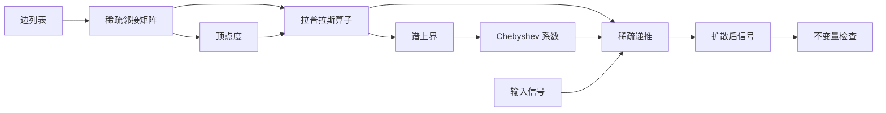

## 摘要

图上的扩散是一个很小的数学观念，却具有异常广泛的计算用途。它出现在排序、去噪、半监督学习、共识动力学、热核特征，以及图神经网络的传播层中。本文从组合拉普拉斯算子出发，逐步讨论多项式近似和 Krylov 子空间近似，尤其关注一个边界：如何把干净的谱公式转化为在大型稀疏图上仍然稳定的实现。

核心对象是热算子

$$
H_t = \exp(-tL), \qquad t \ge 0,
$$

其中 $L$ 是图拉普拉斯算子。精确特征分解能够清楚展示几何结构；快速求解器则用局部递推、稀疏矩阵乘法与可控近似误差取代它。

:::note[记号]
向量均为列向量。对于实对称矩阵 $A$，其有序特征值记作 $\lambda_1(A) \le \cdots \le \lambda_n(A)$。欧几里得范数与算子范数均写作 $\lVert\cdot\rVert_2$，由上下文区分。
:::

## 一、图、信号与拉普拉斯算子

令 $G=(V,E,w)$ 为一个具有 $n=|V|$ 个顶点的无向加权图。它的邻接矩阵 $A\in\mathbb{R}^{n\times n}$ 满足 $A_{ij}=w_{ij}=w_{ji}\ge 0$，度矩阵为

$$
D = \operatorname{diag}(d_1,\ldots,d_n),
\qquad
d_i = \sum_{j=1}^{n} A_{ij}.
$$

**组合拉普拉斯算子**、**对称归一化拉普拉斯算子**与**随机游走拉普拉斯算子**分别为

$$
L = D-A,
\qquad
L_{\mathrm{sym}} = I-D^{-1/2}AD^{-1/2},
\qquad
L_{\mathrm{rw}} = I-D^{-1}A.
$$

对于孤立顶点，逆度因子定义为零。图信号是一个向量 $x\in\mathbb{R}^n$，其坐标 $x_i$ 附着于顶点 $i$。

### 1.1 二次型

恒等式

$$
x^\top Lx
= \frac12\sum_{i,j=1}^{n}A_{ij}(x_i-x_j)^2
= \sum_{\{i,j\}\in E}w_{ij}(x_i-x_j)^2
$$

立刻证明了 $L\succeq 0$。它也解释了低频信号为什么是平滑的：这类信号在权重较大的边上变化很小。

:::important[能量原理]
拉普拉斯算子不只是一种编码邻接关系的矩阵。它的二次型为“不一致”赋予能量。扩散会降低这种能量，同时在每一个连通分量上保持总质量。
:::

如果 $G$ 有 $c$ 个连通分量，那么

$$
\dim\ker L = c,
$$

各连通分量的示性向量张成零空间。对于连通图，$\lambda_1=0$ 是单特征值，而**谱间隙** $\lambda_2>0$ 控制最慢的非常数模态。

### 1.2 一个小例子

四个顶点的路径图具有拉普拉斯矩阵

$$
L=
\begin{bmatrix}
 1 & -1 & 0 & 0 \\
 -1 & 2 & -1 & 0 \\
 0 & -1 & 2 & -1 \\
 0 & 0 & -1 & 1
\end{bmatrix}.
$$

把 $L$ 作用于 $x=(1,1,0,0)^\top$，得到 $(0,1,-1,0)^\top$：只有信号发生变化的边界对离散导数作出贡献。

## 二、热流与谱滤波

连续时间扩散方程为

$$
\frac{d}{dt}x(t)=-Lx(t),
\qquad x(0)=x_0.
$$

由于 $L$ 对称，它具有分解 $L=U\Lambda U^\top$，其中 $U^\top U=I$，且 $\Lambda=\operatorname{diag}(\lambda_1,\ldots,\lambda_n)$。因此

$$
x(t)=e^{-tL}x_0
=Ue^{-t\Lambda}U^\top x_0
=\sum_{k=1}^{n}e^{-t\lambda_k}\langle u_k,x_0\rangle u_k.
$$

每个特征向量 $u_k$ 都是一个图 Fourier 模态，而 $e^{-t\lambda_k}$ 是低通乘子。较大的特征值快速衰减，零空间分量则保持不变。

:::tip[实现中的合理性检查]
对于无向图，计算得到的热算子应当对称，在有限 $t$ 上正定，在二范数下收缩，并且保持质量：$H_t\mathbf{1}=\mathbf{1}$。
:::

### 2.1 长时间行为

在连通图上，

$$
\lim_{t\to\infty}e^{-tL}
=u_1u_1^\top
=\frac{1}{n}\mathbf{1}\mathbf{1}^\top.
$$

此外，对于每个与 $\mathbf{1}$ 正交的 $x_0$，

$$
\lVert e^{-tL}x_0\rVert_2
\le e^{-t\lambda_2}\lVert x_0\rVert_2.
$$

这个不等式赋予谱间隙以可操作的意义：若要把非常数分量缩小到原来的 $\varepsilon$，只需满足

$$
t \ge \frac{1}{\lambda_2}\log\frac{1}{\varepsilon}.
$$

### 2.2 预解式与正则化

热核是更大谱滤波器家族的一员。Tikhonov 平滑求解

$$
x_\mu
=\arg\min_x\left\{
\frac12\lVert x-y\rVert_2^2
+\frac{\mu}{2}x^\top Lx
\right\},
$$

其最优性条件给出

$$
(I+\mu L)x_\mu=y,
\qquad
x_\mu=(I+\mu L)^{-1}y.
$$

在图 Fourier 基底中，对应乘子是 $(1+\mu\lambda)^{-1}$。热扩散以指数速度压制高频，预解式则以有理函数方式压制高频。

| 滤波器 | 谱响应 $g(\lambda)$ | 典型用途 |
| --- | --- | --- |
| 热核 | $e^{-t\lambda}$ | 多尺度平滑 |
| 预解式 | $(1+\mu\lambda)^{-1}$ | 正则化估计 |
| 惰性随机游走 | $(1-\alpha\lambda)^k$ | 局部传播 |
| 理想截断 | $\mathbf{1}_{\lambda\le\tau}$ | 理论分析，很少直接计算 |

## 三、离散化与稳定性

步长为 $h$ 的显式 Euler 格式为

$$
x_{k+1}=(I-hL)x_k.
$$

稳定性要求对每一个 $i$ 都有 $|1-h\lambda_i|\le 1$，因此

$$
0\le h\le\frac{2}{\lambda_{\max}(L)}.
$$

如果还希望组合拉普拉斯算子对应的 $I-hL$ 逐项非负，那么更严格的充分条件 $h\le 1/d_{\max}$ 很自然。

:::warning[看似无害的步长]
如果按运行时间是否方便，而不是按谱来选择 $h$，就可能造成振荡或发散。在高度异质的图中，对平均度安全的步长，未必对枢纽顶点安全。
:::

隐式 Euler 格式

$$
(I+hL)x_{k+1}=x_k
$$

无条件稳定，但需要求解线性系统。Crank–Nicolson 格式使用

$$
\left(I+\frac{h}{2}L\right)x_{k+1}
=\left(I-\frac{h}{2}L\right)x_k,
$$

具有二阶精度，不过在较大的 $h$ 下不一定保持单调。

### 3.1 误差分解

对于数值近似 $\widetilde{x}(t)$，将误差分成两部分很有帮助：

$$
\lVert \widetilde{x}(t)-e^{-tL}x_0\rVert_2
\le
\underbrace{\lVert \widetilde{x}(t)-p_m(L)x_0\rVert_2}_{\text{算术或求解器误差}}
+
\underbrace{\lVert p_m(L)-e^{-tL}\rVert_2\lVert x_0\rVert_2}_{\text{近似误差}}.
$$

这种分解避免一种常见调试错误：提高浮点精度无法修复次数不足的多项式。

## 四、不计算特征向量的快速近似

稠密特征分解需要 $O(n^3)$ 时间与 $O(n^2)$ 内存。对于具有 $m=|E|$ 条边的稀疏图，真正相关的基本操作是稀疏矩阵—向量乘法，其代价为 $O(m+n)$。

### 4.1 Chebyshev 近似

假设 $L$ 的谱位于 $[0,\lambda_{\max}]$。通过

$$
\widetilde{L}=\frac{2}{\lambda_{\max}}L-I
$$

把谱映射到 $[-1,1]$，再用

$$
p_K(L)=\sum_{k=0}^{K}c_kT_k(\widetilde{L})
$$

近似 $e^{-tL}$，其中 $T_0(z)=1$、$T_1(z)=z$，并且

$$
T_{k+1}(z)=2zT_k(z)-T_{k-1}(z).
$$

算法只需要三个工作向量。系数可以通过目标函数在 Chebyshev 节点上的离散余弦变换求得。

```python
from __future__ import annotations

import numpy as np
from scipy.sparse import csr_matrix, eye


def chebyshev_apply(
    laplacian: csr_matrix,
    signal: np.ndarray,
    coefficients: np.ndarray,
    lambda_max: float,
) -> np.ndarray:
    """把 Chebyshev 多项式作用于稀疏图信号。"""
    n = laplacian.shape[0]
    scaled = (2.0 / lambda_max) * laplacian - eye(n, format="csr")

    t0 = signal.copy()
    result = coefficients[0] * t0
    if len(coefficients) == 1:
        return result

    t1 = scaled @ signal
    result += coefficients[1] * t1

    for coefficient in coefficients[2:]:
        t2 = 2.0 * (scaled @ t1) - t0
        result += coefficient * t2
        t0, t1 = t1, t2

    return result
```

:::caution[不要猜测谱区间]
如果对 $\lambda_{\max}$ 的估计太小，部分谱会被映射到 $[-1,1]$ 之外，而 Chebyshev 递推在该区域可能迅速增长。安全的上界胜过乐观但错误的估计。
:::

### 4.2 Krylov 投影

$r$ 维 Krylov 空间为

$$
\mathcal{K}_r(L,x_0)
=\operatorname{span}\{x_0,Lx_0,\ldots,L^{r-1}x_0\}.
$$

Lanczos 迭代构造正交归一基 $Q_r$ 与对称三对角矩阵 $T_r=Q_r^\top LQ_r$。于是

$$
e^{-tL}x_0
\approx
\lVert x_0\rVert_2 Q_r e^{-tT_r}e_1.
$$

高代价计算仍然是稀疏的；只有小型 $r\times r$ 矩阵的指数是稠密计算。

:::fold[Lanczos 热扩散步骤的伪代码]
```text
q₁ ← x / ‖x‖₂
q₀ ← 0, β₀ ← 0
for j = 1, …, r:
    z ← Lqⱼ − βⱼ₋₁qⱼ₋₁
    αⱼ ← qⱼᵀz
    z ← z − αⱼqⱼ
    z ← reorthogonalize(z, q₁, …, qⱼ)
    βⱼ ← ‖z‖₂
    qⱼ₊₁ ← z / βⱼ
return ‖x‖₂ Qᵣ exp(−tTᵣ)e₁
```
:::

## 五、实现流水线

计算依赖可以概括如下：



### 5.1 TypeScript 参考类型

```typescript
type VertexId = number

interface WeightedEdge {
  readonly source: VertexId
  readonly target: VertexId
  readonly weight: number
}

interface CSRMatrix {
  readonly rows: number
  readonly rowPtr: Uint32Array
  readonly columnIndex: Uint32Array
  readonly values: Float64Array
}

export function assertFiniteSignal(x: Float64Array): void {
  for (const [index, value] of x.entries()) {
    if (!Number.isFinite(value))
      throw new RangeError(`signal[${index}] is not finite: ${value}`)
  }
}
```

### 5.2 Rust 稀疏乘法

```rust
#[derive(Debug)]
pub struct CsrMatrix {
    pub rows: usize,
    pub row_ptr: Vec<usize>,
    pub col_idx: Vec<usize>,
    pub values: Vec<f64>,
}

impl CsrMatrix {
    pub fn mul_vec(&self, x: &[f64]) -> Vec<f64> {
        assert_eq!(x.len(), self.rows);
        let mut y = vec![0.0; self.rows];

        for row in 0..self.rows {
            let range = self.row_ptr[row]..self.row_ptr[row + 1];
            y[row] = range
                .map(|p| self.values[p] * x[self.col_idx[p]])
                .sum();
        }
        y
    }
}
```

### 5.3 储存加权边

```sql
CREATE TABLE graph_edge (
    graph_id     BIGINT           NOT NULL,
    source_id    BIGINT           NOT NULL,
    target_id    BIGINT           NOT NULL,
    weight       DOUBLE PRECISION NOT NULL CHECK (weight >= 0),
    PRIMARY KEY (graph_id, source_id, target_id),
    CHECK (source_id < target_id)
);

CREATE INDEX graph_edge_target_idx
    ON graph_edge (graph_id, target_id);
```

### 5.4 可复现的命令行运行

```bash
set -euo pipefail

python -m graphdiff.prepare \
  --edges data/edges.parquet \
  --output build/graph.npz

python -m graphdiff.solve \
  --graph build/graph.npz \
  --time 2.5 \
  --degree 48 \
  --seed 20260830
```

配置可以保持为普通、便于审阅的文本：

```yaml
operator: combinatorial-laplacian
solver:
  method: chebyshev
  degree: 48
  spectral_bound: power-iteration
validation:
  mass_tolerance: 1.0e-10
  energy_tolerance: 1.0e-12
```

## 六、测试数学不变量

数值测试应当表达数学事实，而不只是检查样例输出。

```python
def test_heat_step_preserves_mass(heat_step, signal):
    result = heat_step(signal, time=0.75)
    assert abs(result.sum() - signal.sum()) < 1e-10


def test_heat_step_does_not_increase_laplacian_energy(
    heat_step, laplacian, signal
):
    before = signal @ (laplacian @ signal)
    result = heat_step(signal, time=0.75)
    after = result @ (laplacian @ result)
    assert after <= before + 1e-12
```

优化期间可以使用一份紧凑检查表：

- [x] 对称性，或明确记录有向图语义；
- [x] 非负权重与明确的孤立顶点策略；
- [x] 在容差范围内保持质量；
- [x] Dirichlet 能量不增加；
- [ ] 基准测试与正确性测试分离；
- [ ] 在多种谱间隙上测试近似次数。

:::fold[为什么逐分量测试不够？]
一个求解器可能在少量手写图上产生看似合理的数值，却在更大输入上违反结构不变量。基于性质的测试可以生成非负对称邻接矩阵，形成拉普拉斯算子，并在许多信号与时间尺度上检查守恒性和收缩性。
:::

## 七、复杂度与方法选择

令 $m$ 为无向边数量，$K$ 为多项式次数，$r$ 为 Krylov 空间维数，$s$ 为右端项数量。

| 方法 | 时间 | 额外内存 | 最合适的情形 |
| --- | ---: | ---: | --- |
| 稠密特征分解 | $O(n^3+sn^2)$ | $O(n^2)$ | 小型图、许多滤波器 |
| 显式 Euler | $O(km)$ | $O(n)$ | 简单局部步骤、严格控制稳定性 |
| Chebyshev | $O(Km)$ | $O(n)$ | 谱区间已知、多个相似信号 |
| Lanczos/Krylov | $O(rm+r^2n+r^3)$ | $O(rn)$ | 少量信号需要高精度 |
| 隐式求解 | 取决于求解器 | 取决于求解器 | 刚性问题、可复用预条件器 |

渐近复杂度表不是最终判决。缓存局部性、图划分、系数复用、加速器传输与停止准则，都可能主导实际运行时间。

## 八、结论

谱记号赋予图扩散以概念上的简洁：

$$
g(L)x=Ug(\Lambda)U^\top x.
$$

稀疏计算则赋予它规模。真正的技艺，在于保持谱表达式的意义，同时用可以审计、估计误差和测试的递推取代全局特征向量。Chebyshev 方法利用谱区间；Krylov 方法让局部子空间适应信号；隐式方法则用线性求解换取无条件稳定性。

这个教训超越了扩散本身。只要一个矩阵函数容易定义却难以显式形成，正确的计算对象往往不是矩阵 $g(L)$ 本身，而是它的作用 $g(L)x$，以及能够证明这种作用仍然忠于数学结构的不变量。

> 计算作用，保持不变量，并把近似误差当作一等对象。

[AI 生成｜仅用于测试]
