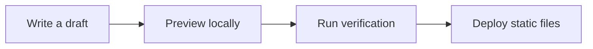

This page is both a readable sample and a visual smoke test. Keep it while adapting the theme, or delete it when your own archive is ready.

## Prose and emphasis

Pelagic supports **bold text**, *italics*, ~~strikethrough~~, [links](https://astro.build/), inline `code`, footnotes,[^note] and ordinary block quotes.

> Good typography does not make every sentence dramatic. It makes structure legible and sustained reading comfortable.

### Lists and tasks

- A short unordered list
- A second item with **emphasis**
  - A nested observation

1. Draft the argument.
2. Revise the structure.
3. Publish only after previewing the production build.

- [x] Configure the site
- [x] Preview locally
- [ ] Replace the sample content

## Structured information

Wide tables remain on one line and scroll horizontally when necessary. Authors can insert an explicit line break when compact wrapping is preferable.

| Capability | Default behavior | Per-post control |
| --- | --- | --- |
| Body typeface | EB Garamond | `bodyFont: garamond` or `sans` |
| Reading width | 50 rem | Global layout configuration |
| Table of contents | Enabled | `toc: true` or `false` |
| Comments | Disabled | Global Giscus configuration |

:::tip[Use callouts sparingly]
Callouts work best when they clarify a real exception, warning, or useful aside. They should not replace the hierarchy of the article.
:::

:::warning[Drafts are local]
Posts with `draft: true` appear during development but are excluded from production pages, feeds, and generated social images.
:::

:::fold[What other callout names are available?]
Use `note`, `tip`, `important`, `warning`, or `caution` after the opening `:::`. A fold block requires a title in square brackets.
:::

## Mathematics and code

Inline mathematics such as $e^{i\pi}+1=0$ follows the auxiliary type scale. Display mathematics uses KaTeX:

$$
\int_{-\infty}^{\infty} e^{-x^2}\,dx = \sqrt{\pi}.
$$

Code blocks use syntax highlighting, line numbers, horizontal overflow, and a copy button:

```ts
interface Note {
  title: string
  published: Date
  tags: string[]
}

export function isRecent(note: Note, now = new Date()) {
  const days = (now.valueOf() - note.published.valueOf()) / 86_400_000
  return days <= 30
}
```

### Diagrams

Mermaid diagrams are rendered at build time and can scroll horizontally instead of shrinking beyond legibility.



## A final check

Before publishing a real post, confirm its description, stable `abbrlink`, language, image alt text, and translation links. The repository validator catches the most common omissions automatically.

[^note]: Footnotes are useful for context that would interrupt the main line of reading.
